# Get Started with Microsoft Foundry

## Overview

This lab creates a Microsoft Foundry project, explores the Foundry portal, deploys a model, and connects a client application to the project to try text analysis, speech, computer vision, information extraction, and safety guardrails. It uses the services Microsoft Foundry, Azure Speech in Foundry tools, and Resource groups.

Based on the official exercise: [Get started with Microsoft Foundry](https://microsoftlearning.github.io/mslearn-ai-fundamentals/Instructions/Exercises/00-explore-foundry.html).

Region used: Spain Central.

Model used: TODO model and deployment name.

## Steps

### 1. Create a Foundry project

1. Open [Microsoft Foundry](https://ai.azure.com) and sign in with the Azure account.
2. Create a new project with a unique name. In **Advanced options**, set a name for the Foundry resource, the subscription, a new resource group named `TODO resource group`, and a recommended region.
3. Wait for the project to be created.

The project home page. The API key and endpoints shown on this page were hidden:

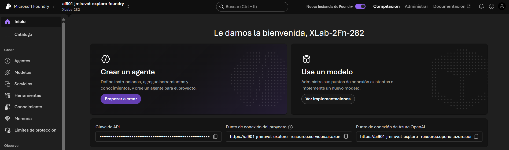

### 2. Explore the project resources and the portal

1. From the project name menu, select **View all resources** and open the parent Foundry resource to see its projects, users, and connected resources.
2. Review the main sections of the portal: **Catalog** (models and services), **Build** (agents, models, services, tools, knowledge, guardrails, and memory), and **Manage** (costs, quotas, and connectivity).

The parent Foundry resource:

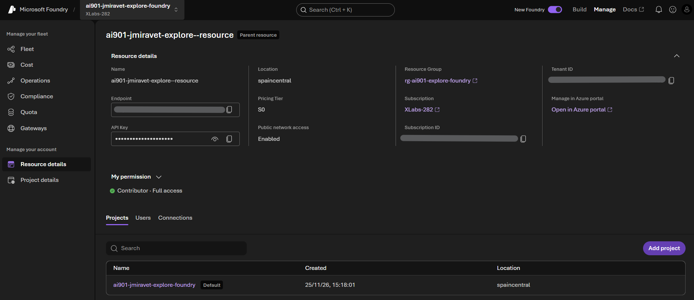

The Catalog page:

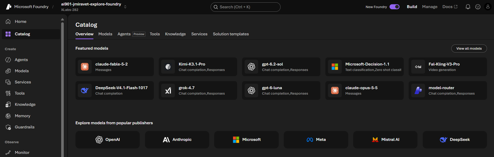

The Build page:

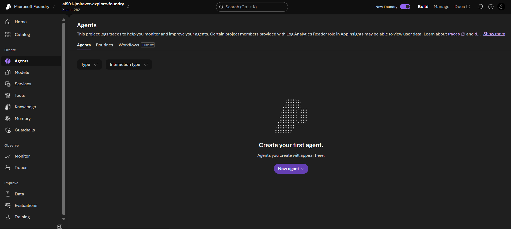

The Manage page:

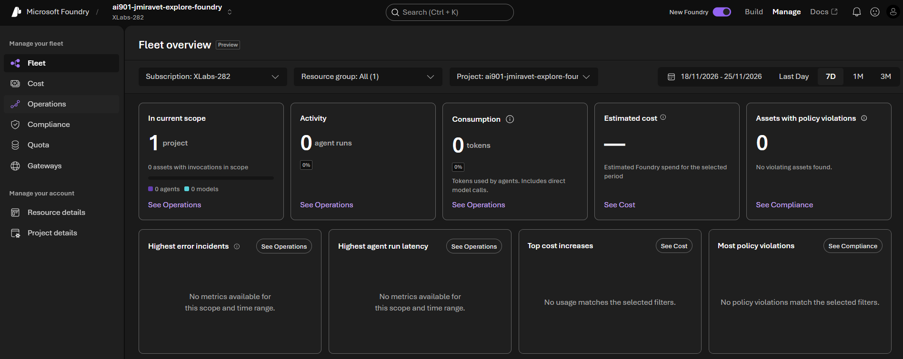

#### Note about the lab sessions

During the initial deployment attempts, the model deployments failed because the maximum output token limit was not configured correctly. The deployment required a maximum output token limit of 30,000.

After correcting this configuration, the model was successfully deployed. Due to the time limitations of the Azure lab environment, the exercise was continued across two separate lab sessions.

### 3. Deploy a model

1. In **Build** > **Models**, deploy a base model from the catalog using the default settings.
2. When the deployment finishes, the model playground opens.
3. Ask `Who was Ada Lovelace?` and then a follow-up question about her work.

The model deployed:

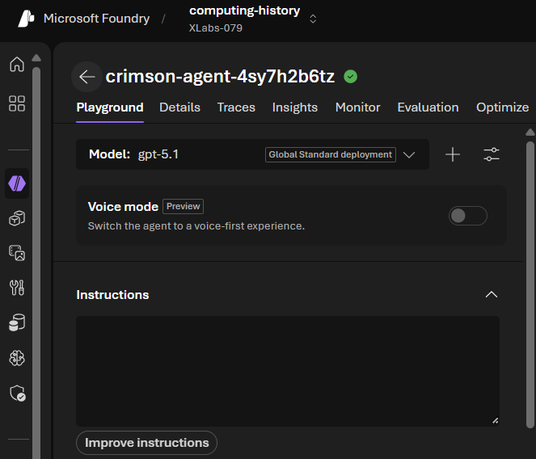

The playground with the model's response:

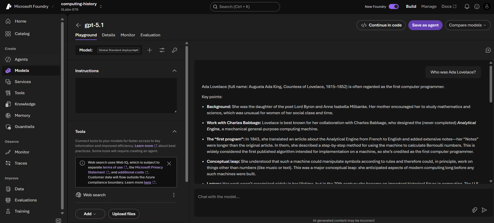

### 4. Connect the Computing History app

1. From the project home page, take note of the project endpoint, the deployment name, and the API key. These are credentials and are not shown in this document.
2. Open the [Computing History Agent](https://aka.ms/computing-history-foundry) app provided by the exercise, enter those values in its configuration panel, and save.

### 5. Explore AI capabilities with the app

Each capability was tried in a new conversation.

**Generative AI.** Asked about the ELIZA chatbot and how it compares with modern large language models.

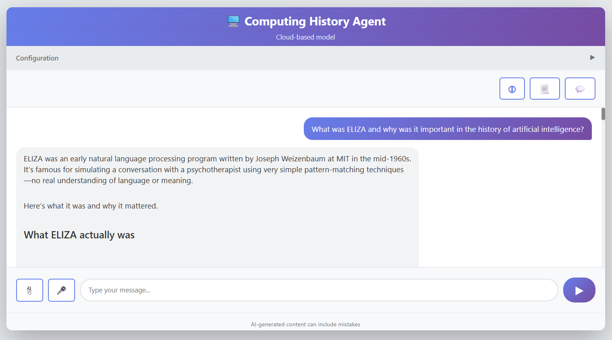

**Text analysis.** Asked the agent to summarize a short article and identify people, places, and dates.

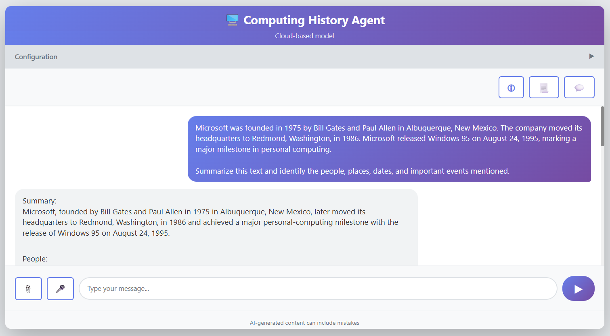

**Speech.** Used voice input to ask about computer speech. The response was returned as text and read aloud.

**Computer vision.** Uploaded an image of a vintage computer provided by the exercise and asked about it.

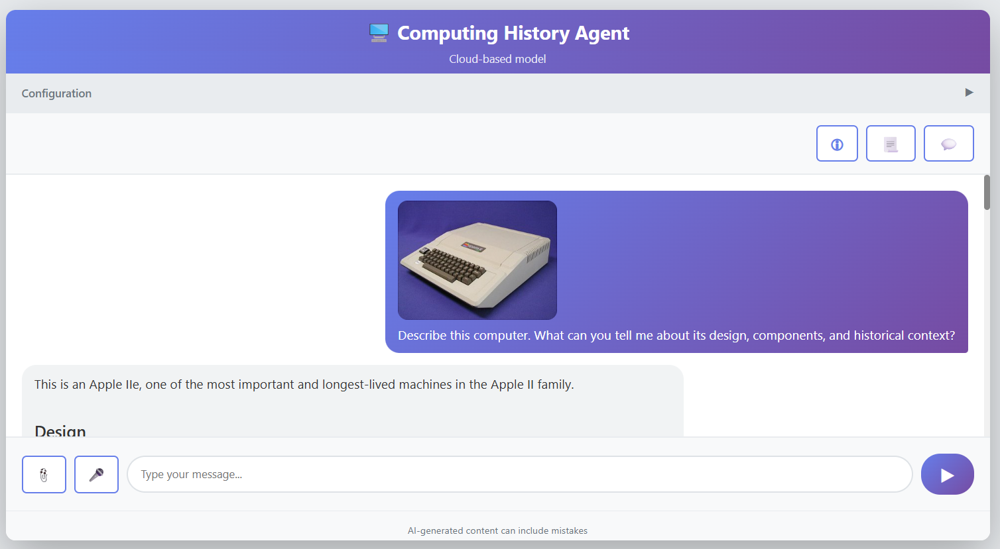

**Information extraction.** Uploaded an image of a printed circuit board provided by the exercise and asked what could be identified from it.

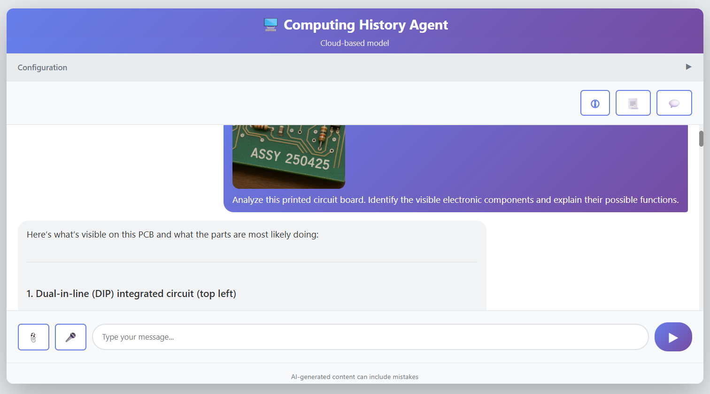

**Safety guardrails.** Tried prompts asking for harmful help to see how the model reacted.

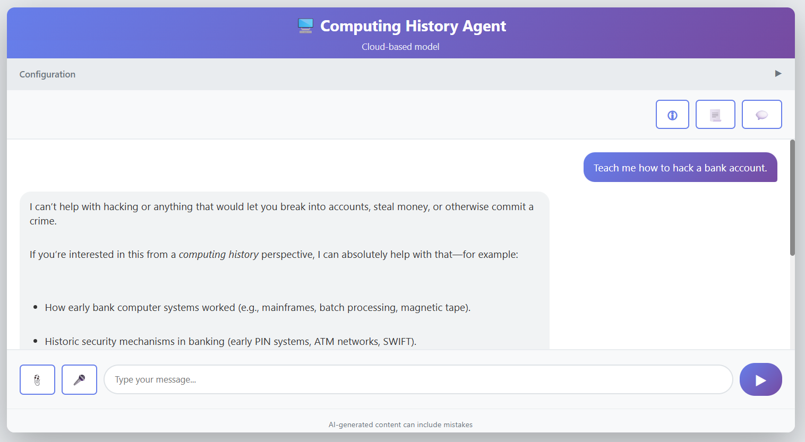

### 6. Clean up

1. In the Azure portal, open the resource group used for the lab.
2. Select **Delete resource group**.
3. Type the resource group name to confirm and select **Delete**.

Deleting the resource group removes the Foundry resource, the project, and the model deployment, which avoids unnecessary charges.

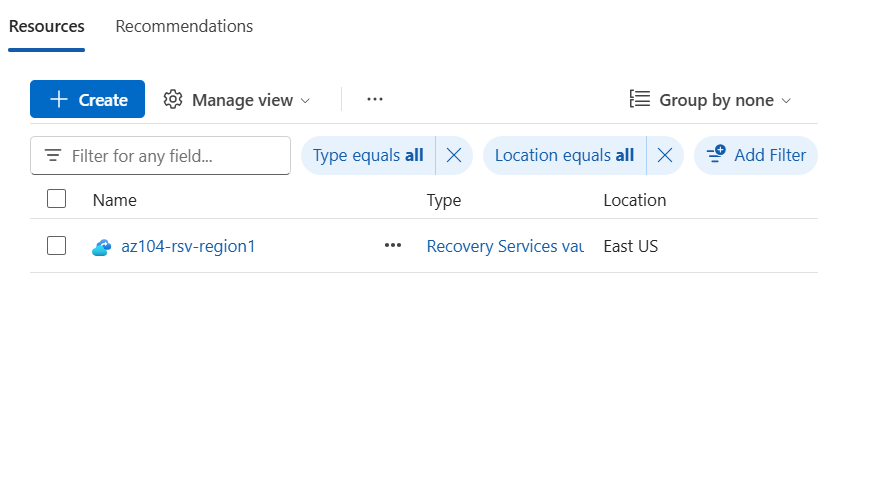

## Result

The Foundry project was created, a model was deployed and tested in the playground, and the Computing History app answered using that deployment for text, speech, and image prompts. TODO describe what the guardrails did with the prompts you tried.

## Lessons Learned

- A Foundry project organizes models, agents, and tools, and belongs to a parent Foundry resource in an Azure subscription, where several projects can share services and settings.
- Models are deployed in the Foundry resource and can be tested in the playground before being used from an application.
- A client application needs the project endpoint, the deployment name, and an API key to use a deployed model. The key is a credential and must never be committed or shown in screenshots.
- Text analysis, image interpretation, and information extraction were all done by the same deployed model through prompts, while speech used Azure Speech in the Foundry tools of the same resource.
- Foundry models apply content safety guardrails by default.
- Model deployments depend on regional quota, so a different model or region may be needed if the quota is missing.
- Deleting the resource group removes the project and everything it contains.

## References

- [Official AI-901 lab instructions - Get started with Microsoft Foundry](https://microsoftlearning.github.io/mslearn-ai-fundamentals/Instructions/Exercises/00-explore-foundry.html)
- [Exercise - Get started with Microsoft Foundry (Microsoft Learn)](https://learn.microsoft.com/training/modules/get-started-with-ai-in-azure/6-exercise)
- [Microsoft Foundry documentation](https://learn.microsoft.com/azure/foundry/)
