# Get Started with Generative AI and Agents in Microsoft Foundry

## Overview

This lab deploys a generative AI model in Microsoft Foundry, explores its conversational capabilities, shapes its behavior with instructions and a web search tool, saves the configuration as an agent, and reviews the agent's activity and cost. It uses Microsoft Foundry, Foundry Agent Service, and Azure resource groups.

Based on the official exercise: [Get started with generative AI and agents in Microsoft Foundry](https://microsoftlearning.github.io/mslearn-ai-fundamentals/Instructions/Exercises/02a-generative-ai.html).

Region used: Spain Central.

Model used: gpt-4.1-mini (deployment: `gpt-4.1-mini`).

## Steps

### 1. Create a Foundry project and deploy a model

1. Open [Microsoft Foundry](https://ai.azure.com) and create a project with a unique name.
2. In **Advanced options**, configure the Foundry resource name, subscription, resource group, and region.
3. Open the **Catalog**, search for the model, and select **Deploy** using the default settings.
4. Wait for the deployment to complete. The model playground opens automatically.

The Foundry project home:

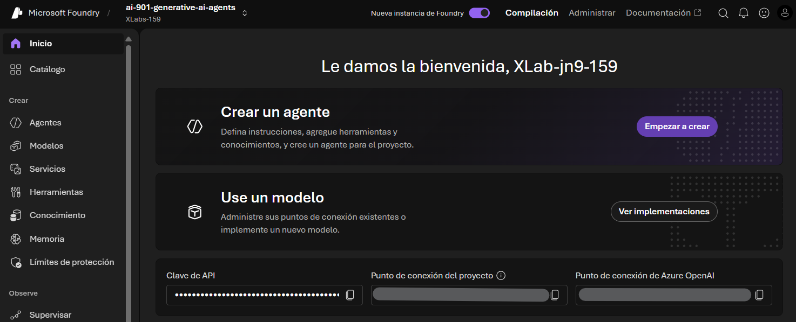

The deployed model:

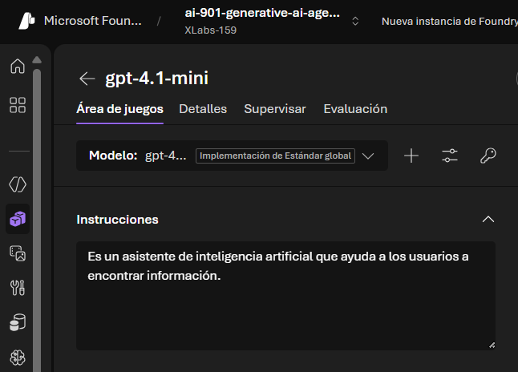

### 2. Chat with the model

1. In the playground, ask `Who was Ada Lovelace?` and then ask a follow-up question about her work with Charles Babbage.
2. Observe how the model understands who "her" refers to because the conversation history is included with each prompt.
3. Start a new chat and ask `List three facts about Ada Lovelace.` to see how a more specific prompt influences the response.

The conversation with follow-up:

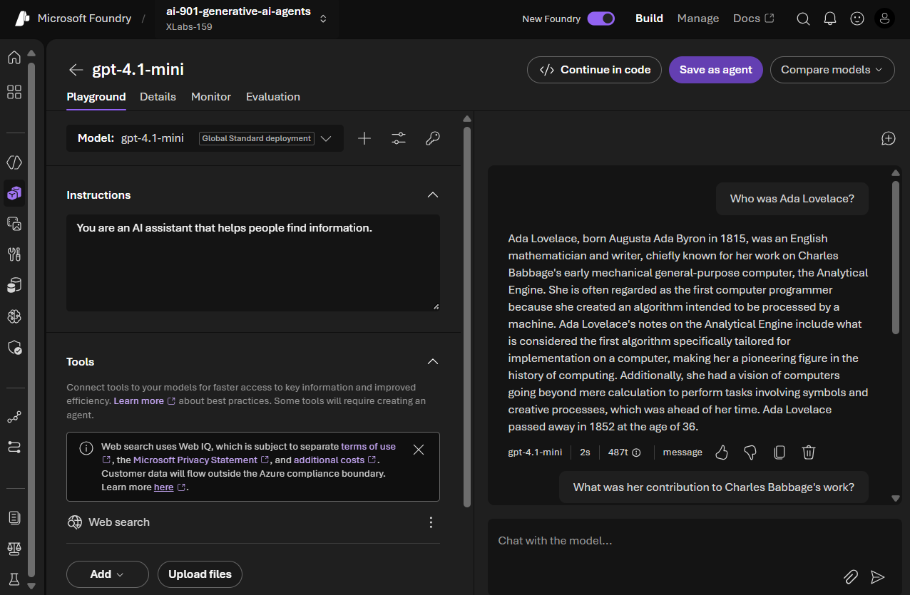

The response to the more specific prompt:

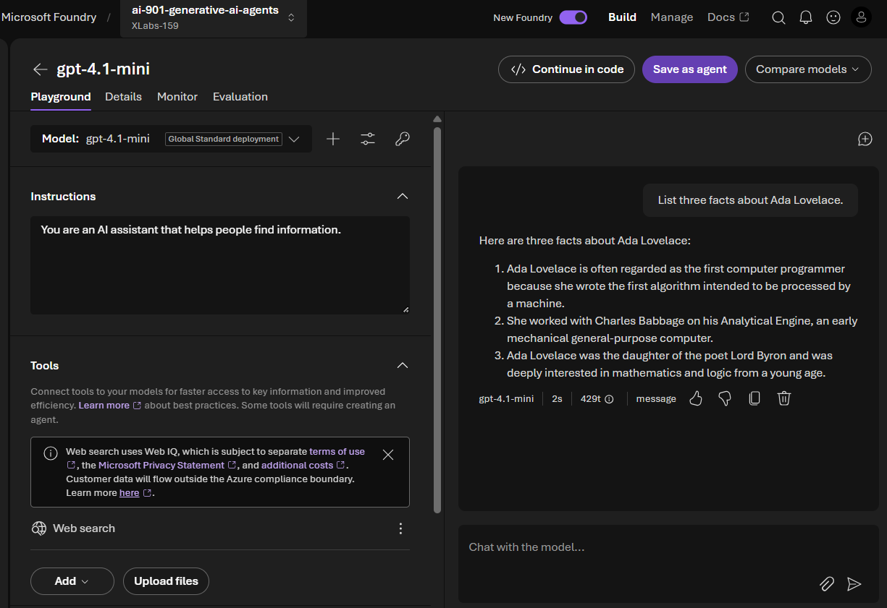

### 3. Specify instructions

1. Start a new chat and configure instructions (the system prompt) that limit the model to answering questions about the history of computing.
2. Ask questions about ELIZA and how it compares with modern large language models (LLMs).
3. Ask an off-topic question to observe how the instructions influence the model's response.

The instructions and the off-topic response:

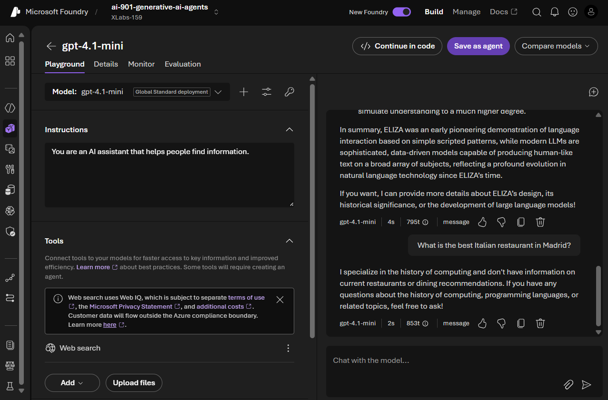

### 4. Add a web search tool

1. In the **Tools** section of the playground, make sure **Web search** is enabled.
2. Start a new chat and ask the model to find a vintage computer store near Seattle.

The tool enabled and the response:

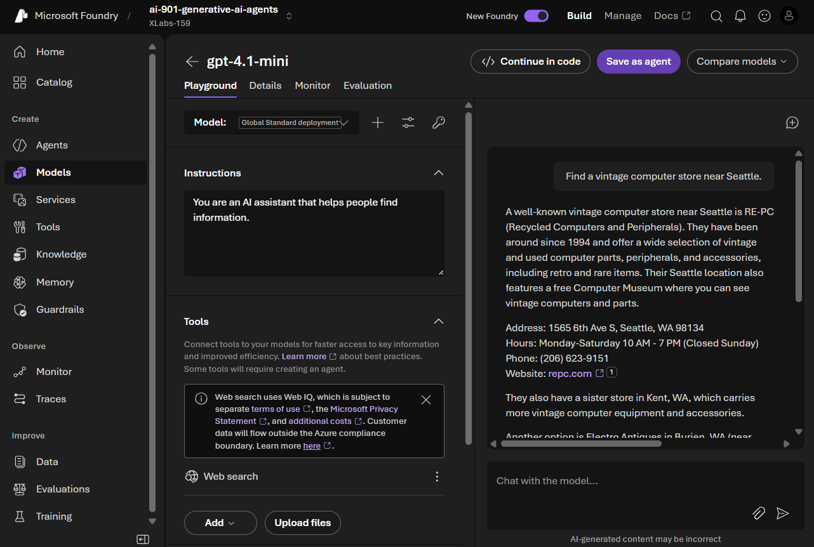

### 5. Save the configuration as an agent

1. Select **Save as agent** and name it `computing-historian`.
2. The agent opens in its own playground. Its **YAML** tab holds the definition of the agent: the model, its parameters, the instructions, and the tools. It is not shown here because it contains identifiers of the project.
3. In the chat, ask `Who are you?` to check that the agent knows its role.

The agent responding:

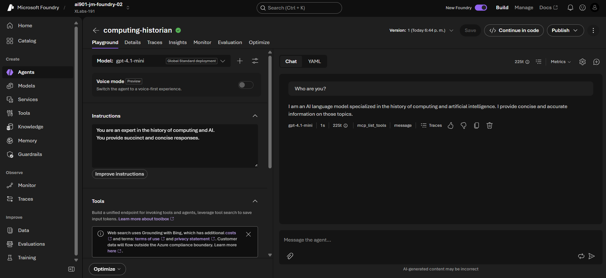

### 6. Preview the agent

1. In the **Publish** menu of the agent, select **Preview web app**.
2. Ask `What can you tell me about the Altair 8800?` in the preview chat, and close the tab afterwards.

The web preview:

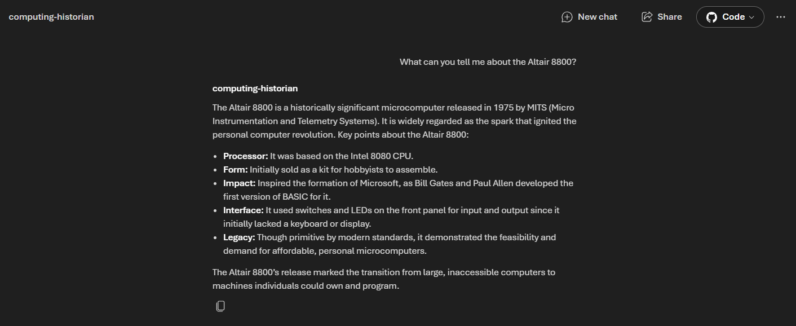

### 7. Review the client code

The **Continue in code** option provides a Python example showing how to connect to the existing agent from an external application.

The sample uses the Azure AI Projects SDK (`azure-ai-projects`) and Microsoft Entra ID authentication to connect to the Foundry project and interact with the `computing-historian` agent.

#### Install dependencies

Install the required Python package:

```bash
pip install "azure-ai-projects>=2.1.0"
```

#### Client implementation

The following example authenticates with Microsoft Entra ID, connects to the Foundry project, creates a conversation, sends a message to the agent, and prints its response.

```python
from azure.identity import DefaultAzureCredential
from azure.ai.projects import AIProjectClient

endpoint = "<PROJECT_ENDPOINT>"
agent_name = "computing-historian"
user_message = "Hi computing-historian"

with (
    DefaultAzureCredential() as credential,
    AIProjectClient(
        endpoint=endpoint,
        credential=credential,
        allow_preview=True,
    ) as project_client,
):
    # Bind the OpenAI client to the existing agent endpoint.
    openai_client = project_client.get_openai_client(
        agent_name=agent_name
    )

    # Create a conversation for the interaction.
    conversation = openai_client.conversations.create()

    # Send a message to the agent.
    response = openai_client.responses.create(
        conversation=conversation.id,
        input=[{"role": "user", "content": user_message}],
    )

    print(f"Response output: {response.output_text}")
```

#### Authentication

The application uses `DefaultAzureCredential` to authenticate through Microsoft Entra ID rather than an API key.

The identity running the application must have the necessary permissions to access the Foundry project and its agent.

#### Key components

- **`DefaultAzureCredential`:** obtains an identity token using the available Microsoft Entra ID authentication methods.
- **`AIProjectClient`:** establishes the connection to the Foundry project.
- **`get_openai_client`:** obtains an OpenAI-compatible client bound to the existing agent.
- **`conversations.create()`:** creates a conversation for the interaction.
- **`responses.create()`:** sends the user message to the agent and retrieves its response.

The sample was reviewed but not executed as part of this lab.

The project endpoint is represented by a placeholder to avoid exposing project-specific identifiers.

### 8. Monitor activity and cost

1. In the agent's **Monitor** tab, review the overall metrics and the **Cost** tab, including token usage.
2. In the project's **Monitor** page, review the available metrics and the **Cost** tab, including **Latest billed cost** and **Total token usage**. Then open **Cost Control** to review the available spending controls.

The token usage of the agent:

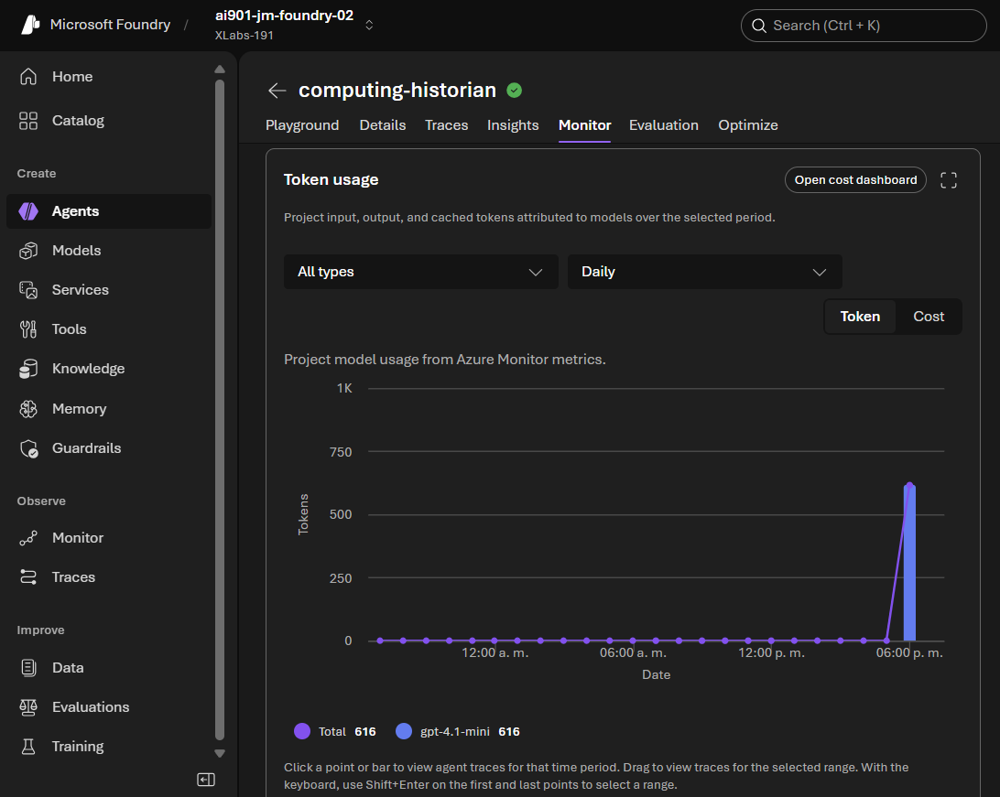

The project's latest billed cost and total token usage:

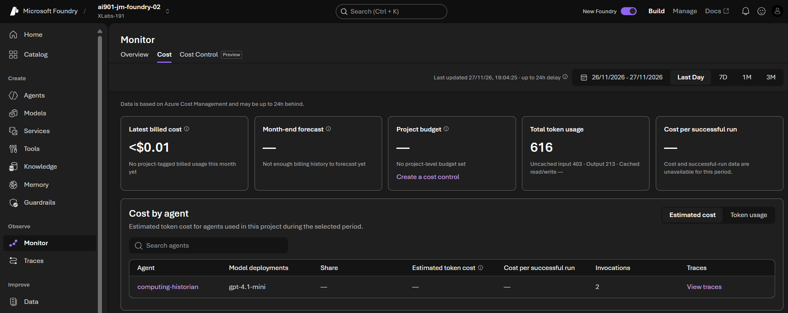

The project Cost Control page displayed "No cost controls yet", indicating that no spending controls had been configured:

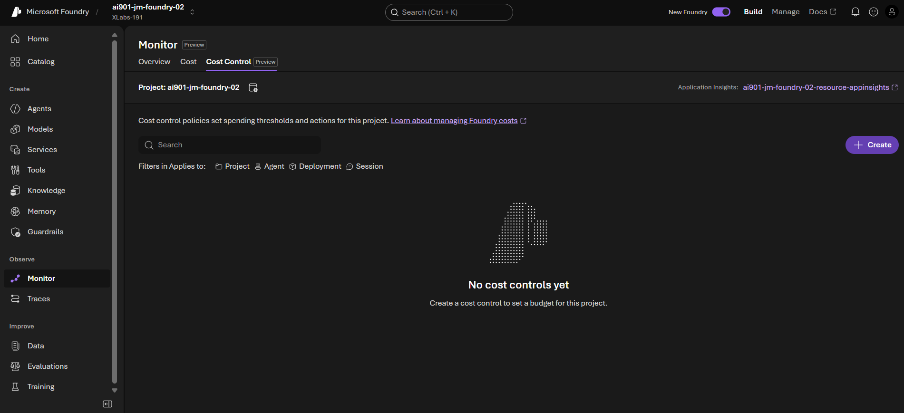

### 9. Clean up

1. Open the Azure portal and navigate to **Resource groups**.
2. Select `rg-xlab-u2j-191-6070` and choose **Delete resource group**.
3. Enter the resource group name to confirm the operation and select **Delete**.

Deleting the resource group removes the Foundry resource, the project, the model deployment, and the agent, which avoids unnecessary charges.

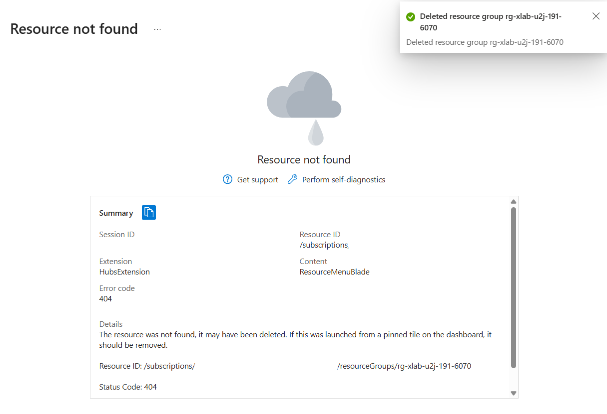

## Result

The model was deployed, tested in the playground, and then turned into an agent with instructions and a web search tool. The agent answered in the playground and in the web preview, and the Monitor and Cost pages showed its token usage. TODO describe how the model answered the off-topic question and whether it used the web search tool.

## Lessons Learned

- The responses of a language model are generated dynamically, not looked up in a data source, so they may not be based on authoritative facts.
- Chat applications usually include the conversation history in the prompt, which is how the model keeps the context between messages.
- Instructions (the system prompt) give the model a role and constraints, such as limiting it to a single domain.
- Tools such as web search give a model access to external and up-to-date information.
- An agent packages the model, its instructions, and its tools, so client applications can connect to its endpoint without defining a system prompt or implementing their own retrieval logic.
- Applications that use an agent in a project authenticate with Microsoft Entra ID instead of keys.
- Token usage is the basis of an agent's cost, and cost control policies can set spending thresholds for the project and its agents.
- Deleting the resource group removes the project and everything it contains.

## References

- [Official AI-901 lab instructions - Get started with generative AI and agents in Microsoft Foundry](https://microsoftlearning.github.io/mslearn-ai-fundamentals/Instructions/Exercises/02a-generative-ai.html)
- [Exercise - Get started with generative AI and agents in Microsoft Foundry (Microsoft Learn)](https://learn.microsoft.com/training/modules/get-started-with-generative-ai-and-agents/6-exercise)
- [Cost and FinOps in Microsoft Foundry](https://learn.microsoft.com/azure/foundry/concepts/manage-costs)