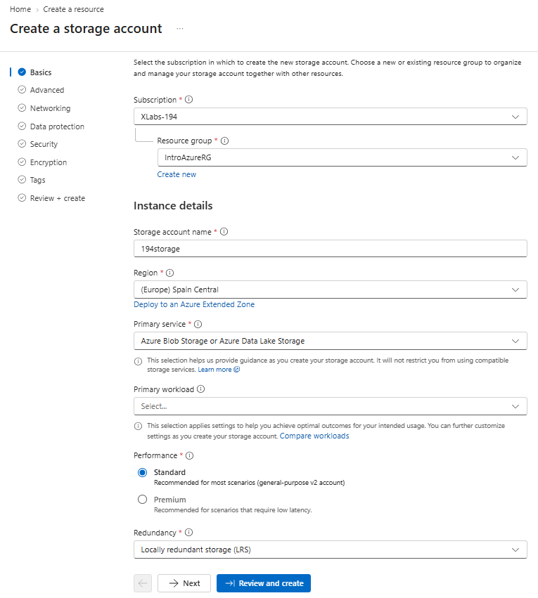
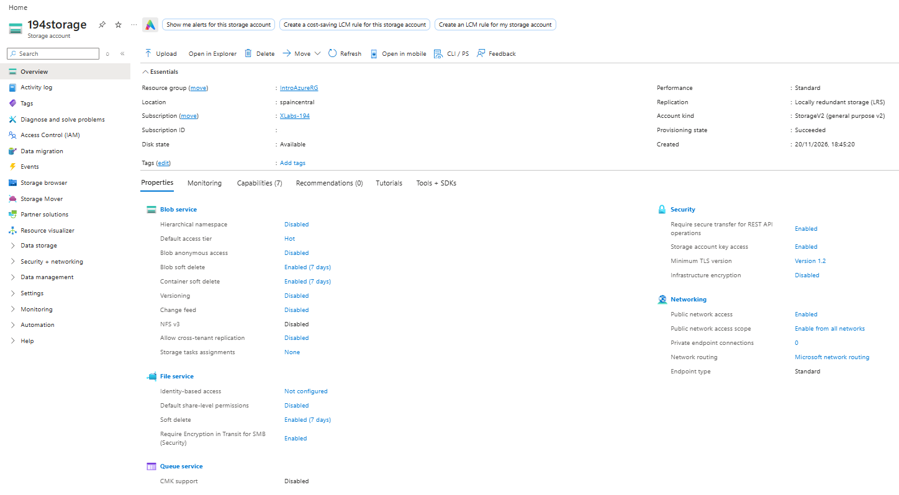
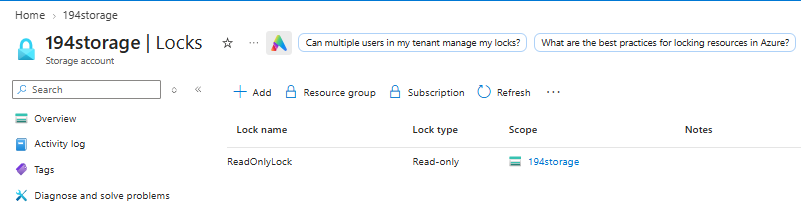
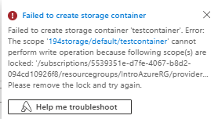
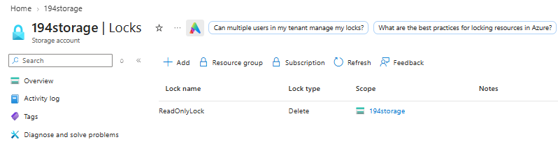
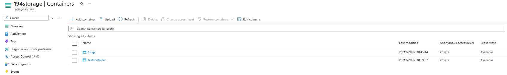
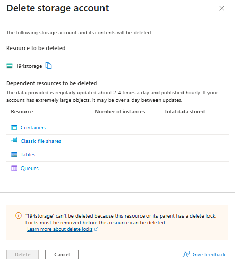
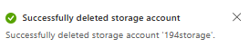
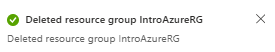
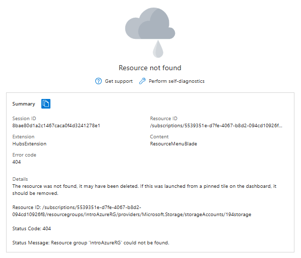

# Configure Resource Locks

## Overview

This lab demonstrates how Azure resource locks protect a storage account against accidental modifications and deletion. It applies a read-only lock and a delete lock to observe how each affects resource operations and demonstrates why locks must be removed before deleting protected resources.

It uses the services Resource groups, Storage accounts, and Resource locks.

Based on the official exercise: [Configure resource locks](https://microsoftlearning.github.io/AZ-900-Microsoft-Azure-Fundamentals/Instructions/Labs/08-exercise-configure-resource-lock.html).

Region used: Spain Central.

## Steps

### 1. Create a resource group and a storage account

1. In the Azure portal, create a resource group named `IntroAzureRG`.
2. Create a storage account in that resource group with a unique name, the same region as the resource group, **Standard** performance, and **Locally redundant storage (LRS)** redundancy. Leave the rest as default.
3. Wait for the deployment to finish and select **Go to resource**.

The storage account was configured with Standard performance, locally redundant storage (LRS), and Spain Central as its region.

The storage account was successfully deployed in the `IntroAzureRG` resource group.

### 2. Apply a read-only lock

1. In the storage account, open **Settings** > **Locks** and select **+ Add**.
2. Enter a lock name, check that the lock type is **Read-only**, and select **OK**.

### 3. Try to add a container

1. Under **Data storage**, select **Containers** and then **+ Container**.
2. Enter a container name and select **Create**.
3. The operation fails with the error **Failed to create storage container** because the read-only lock prevents create and update operations on the storage account.

### 4. Change the lock to Delete and add a container

1. Go back to **Settings** > **Locks**, open the existing lock, change its type to **Delete**, and select **OK**.
2. Repeat the container creation from the previous step.
3. This time the container is created and appears in the list.

The lock with the new type:

The container created:

### 5. Try to delete the storage account

1. In the storage account **Overview**, select **Delete**.
2. Azure blocks the operation because the account has a delete lock.

### 6. Remove the lock and delete the storage account

1. In the storage account, open **Settings** > **Locks** and delete the lock.
2. Go to **Storage accounts**, select the account, and select **Delete**.
3. Type the name of the storage account to confirm and select **Delete**.
4. Check in **Storage accounts** that the account no longer exists.

### 7. Clean up

1. In the Azure portal, open **Resource groups** and select `IntroAzureRG`.
2. Select **Delete resource group**.
3. Type `IntroAzureRG` to confirm and select **Delete**, then confirm in the pop-up window.

A subsequent attempt to access the storage account returned a 404 error, confirming that the resource group and its associated resources were no longer available.

## Result

With the read-only lock in place, creating a container failed. After changing the lock type to **Delete**, the container was created, but deleting the storage account was still blocked. The account could only be deleted after removing the lock.

## Lessons Learned

- A read-only lock prevents modification operations on the protected resource, including creating a container in the storage account.
- A delete lock allows modifications but prevents the protected resource from being deleted.
- A resource protected by a delete lock cannot be deleted until the lock is removed.
- Locks are useful safeguards for critical resources, but they can also block legitimate operations, so the lock type must match the protection requirements.
- Resource locks must be removed before deleting protected resources during cleanup.

## References

- [Official AZ-900 lab instructions - Configure resource locks](https://microsoftlearning.github.io/AZ-900-Microsoft-Azure-Fundamentals/Instructions/Labs/08-exercise-configure-resource-lock.html)
- [Lock your Azure resources to protect your infrastructure](https://learn.microsoft.com/azure/azure-resource-manager/management/lock-resources)
