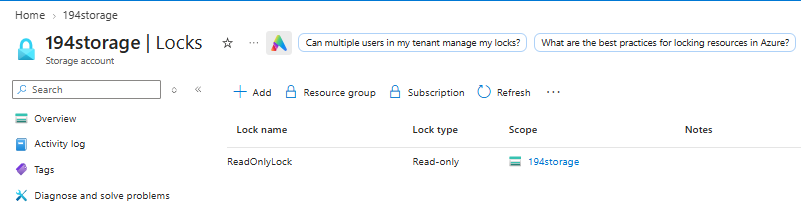
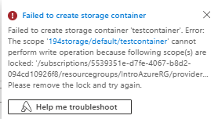
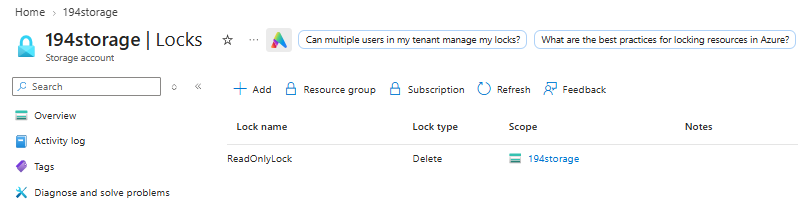
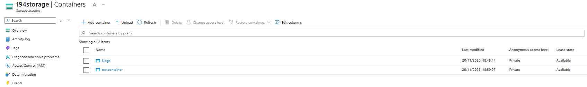
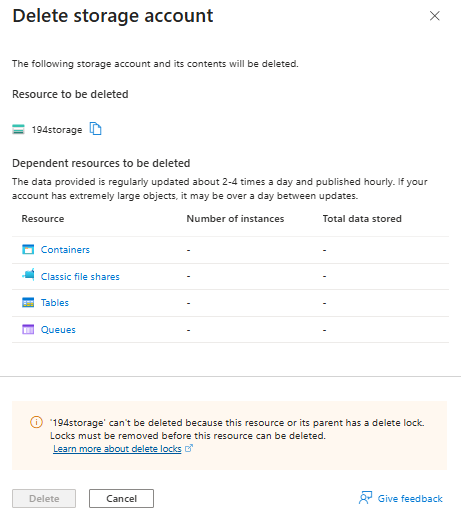

# Configure Resource Locks

## Overview

This lab applies resource locks to a storage account to see how they protect it from accidental changes and deletion. It tests a read-only lock and a delete lock, and shows that a lock has to be removed before the resource can be deleted. It uses the services Resource groups, Storage accounts, and Resource locks.

Based on the official exercise: [Configure resource locks](https://microsoftlearning.github.io/AZ-900-Microsoft-Azure-Fundamentals/Instructions/Labs/08-exercise-configure-resource-lock.html).

Region used: TODO region.

## Steps

### 1. Create a resource group and a storage account

1. In the Azure portal, create a resource group named `IntroAzureRG`.
2. Create a storage account in that resource group with a unique name, the same region as the resource group, **Standard** performance, and **Locally redundant storage (LRS)** redundancy. Leave the rest as default.
3. Wait for the deployment to finish and select **Go to resource**.

### 2. Apply a read-only lock

1. In the storage account, open **Settings** > **Locks** and select **+ Add**.
2. Enter a lock name, check that the lock type is **Read-only**, and select **OK**.

### 3. Try to add a container

1. Under **Data storage**, select **Containers** and then **+ Container**.
2. Enter a container name and select **Create**.
3. The operation fails with this error: TODO exact error shown. The read-only lock prevents create and update operations on the storage account.

### 4. Change the lock to Delete and add a container

1. Go back to **Settings** > **Locks**, open the existing lock, change its type to **Delete**, and select **OK**.
2. Repeat the container creation from the previous step.
3. This time the container is created and appears in the list.

The lock with the new type:

The container created:

### 5. Try to delete the storage account

1. In the storage account **Overview**, select **Delete**.
2. Azure blocks the operation because the account has a delete lock.

