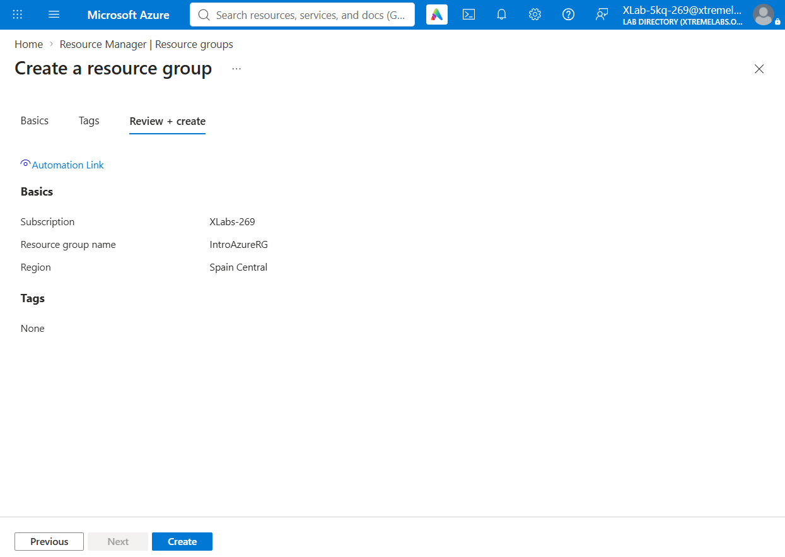
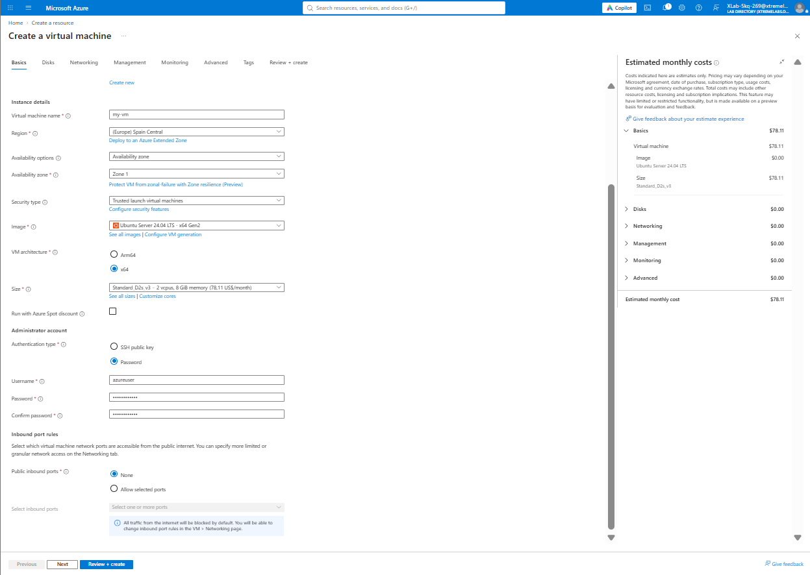
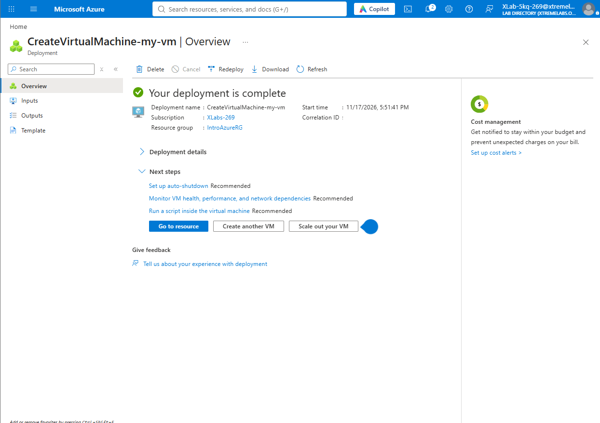
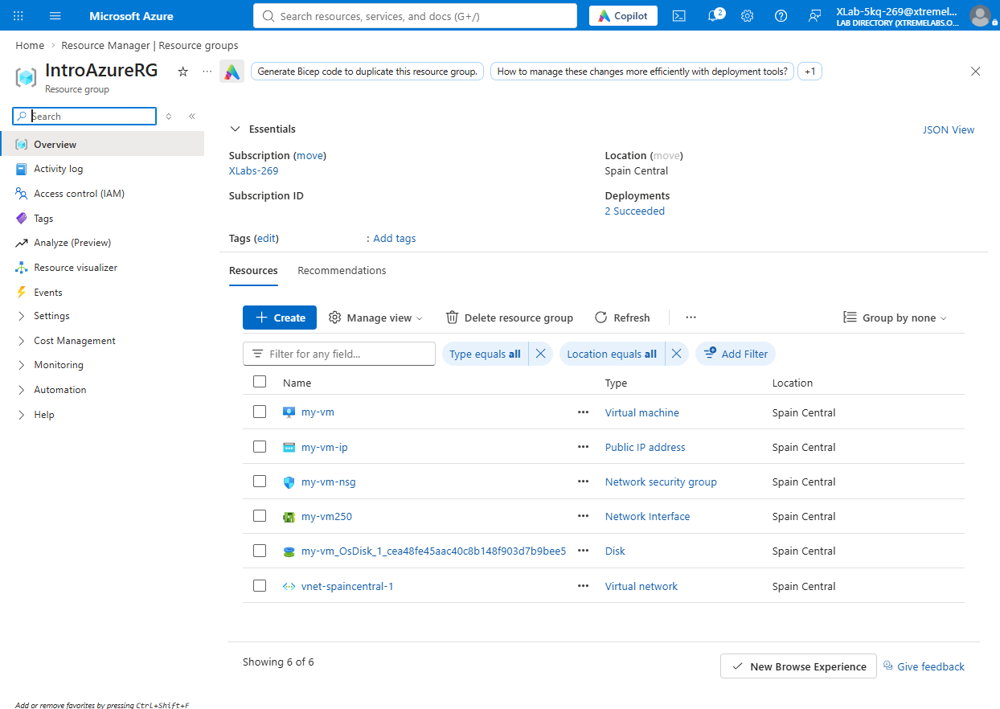
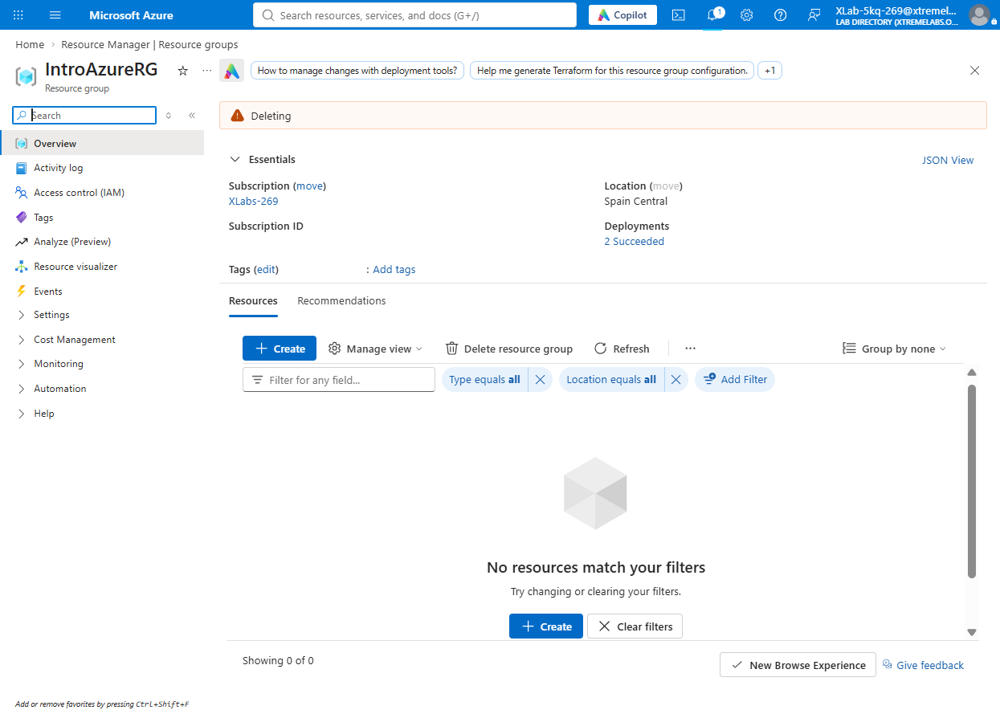

# Create an Azure Resource

## Overview

This lab creates a resource group and a virtual machine in the Azure portal, and observes how Azure groups the resources it creates. It uses the services Resource groups and Virtual Machines.

Based on the official exercise: [Create an Azure resource](https://microsoftlearning.github.io/AZ-900-Microsoft-Azure-Fundamentals/Instructions/Labs/02-exercise-create-azure-resource.html).

Region used: Spain Central.

## Steps

### 1. Create a resource group

1. In the Azure portal, open **Resource groups** and select **Create**.
2. Configure the following settings:

The resource group configuration:

| Setting | Value |
|---|---|
| Subscription | XLabs-731 |
| Resource group | `IntroAzureRG` |
| Region | Spain Central |

3. Select **Review + create** and then **Create**.

The resource group once created:

### 2. Create a virtual machine

1. Select **Create a resource**, then **Infrastructure services**, and create a **Virtual machine**.
2. On the **Basics** tab, set the following values and leave the rest as default:
   - Resource group: `IntroAzureRG`
   - Virtual machine name: `my-vm`
   - Region: same as the resource group
   - Authentication: password, with username `azureuser`
   - Public inbound ports: none
3. Select **Review + create** and then **Create**, and wait for the deployment to finish.

The Basics tab with the values used:

The deployment finished:

### 3. Verify the resources created

1. Go to **Resource groups** and open `IntroAzureRG`.
2. Review the resources listed in the group.

### 4. Clean up

1. Go to **Resource groups** and open `IntroAzureRG`.
2. Select **Delete resource group**.
3. If shown, check the force delete option for virtual machines.
4. Type `IntroAzureRG` to confirm and select **Delete**.

## Result

The deployment completed successfully and `IntroAzureRG` contained 6 resources: virtual machine, OS disk, network interface, public IP address, network security group, and virtual network.

Besides the virtual machine, Azure created the associated resources it needs and placed them in the same resource group.

## Lessons Learned

- Creating a single virtual machine creates several related resources, not just the VM itself.
- A resource group is a container: all the resources of the lab live in one place and can be reviewed together.
- Deleting the resource group removes everything inside it, which makes cleanup quick and avoids leaving resources that keep generating costs.

## References

- [Exercise - Create an Azure resource (Microsoft Learn)](https://learn.microsoft.com/training/modules/describe-core-architectural-components-of-azure/7-exercise-create-azure-resource)
- [Official AZ-900 lab instructions](https://microsoftlearning.github.io/AZ-900-Microsoft-Azure-Fundamentals/Instructions/Labs/02-exercise-create-azure-resource.html)
