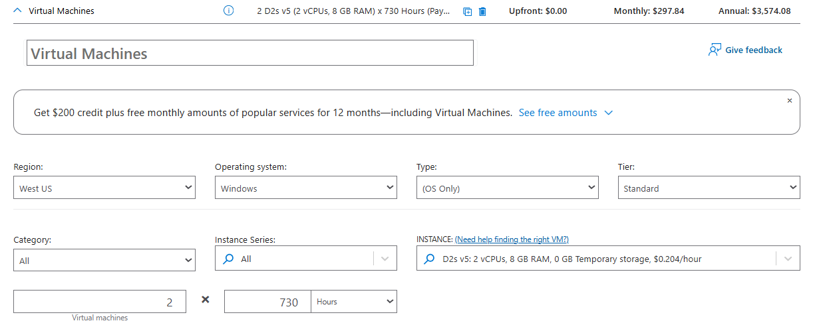
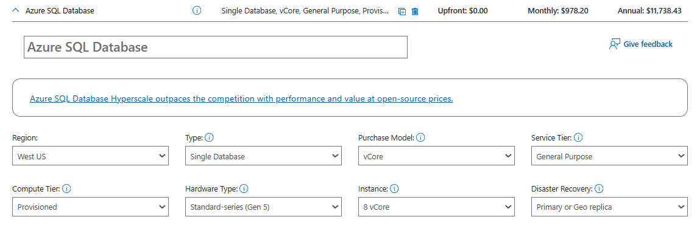
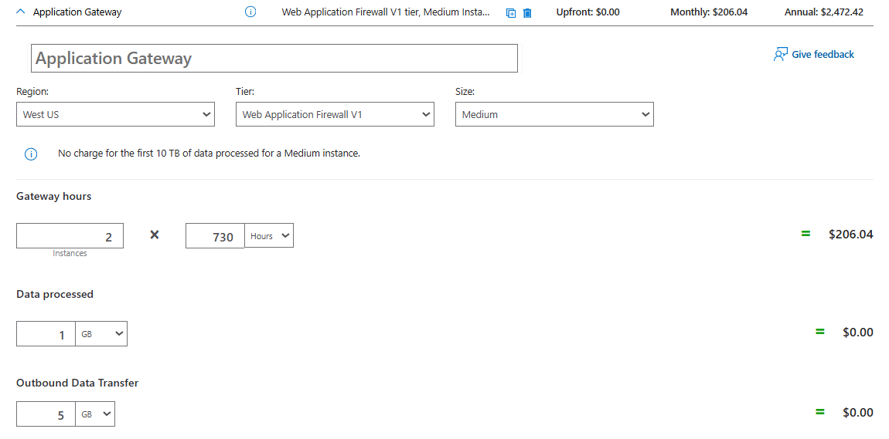
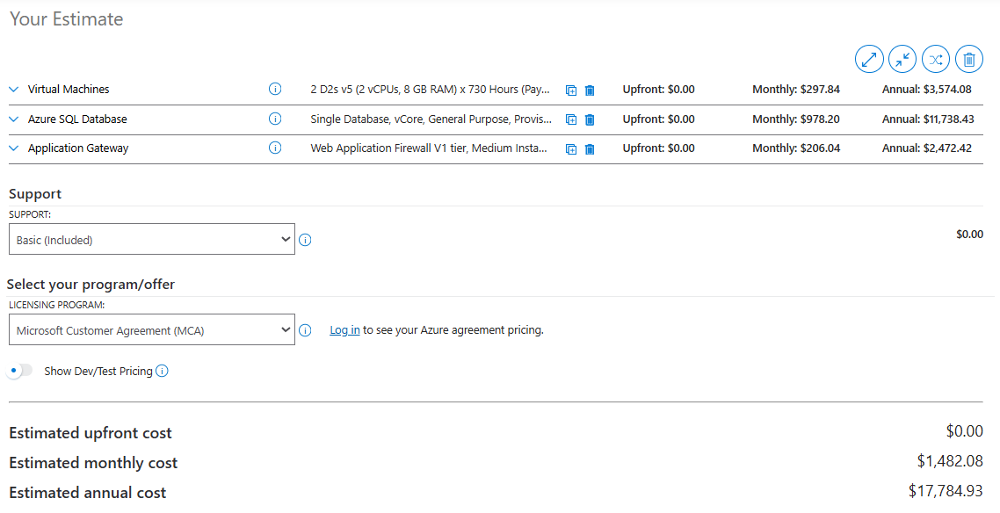

# Estimate Workload Costs Using the Pricing Calculator

## Overview

This lab uses the Azure Pricing Calculator to estimate the monthly cost of running a basic web application in Azure.

The estimated solution includes three Azure services:

- **Azure Virtual Machines:** Two Windows virtual machines hosting the application.
- **Azure SQL Database:** A managed database storing inventory and pricing information.
- **Azure Application Gateway:** A load-balancing service protecting and distributing application traffic.

The estimate is based on a hypothetical internal web application migrated from an on-premises datacenter to Azure.

Based on the official exercise: [Estimate workload costs by using the Pricing calculator](https://microsoftlearning.github.io/AZ-900-Microsoft-Azure-Fundamentals/Instructions/Labs/06-exercise-estimate-workload-costs-use-pricing-calculator.html).

## Steps

### 1. Define the workload requirements

Before creating the estimate, identify the application's requirements and expected resource usage.

The workload has the following characteristics:

| Requirement | Value |
|---|---|
| Application type | Internal ASP.NET web application |
| Operating system | Windows |
| Virtual machines | 2 |
| Monthly running time | 730 hours |
| Network data processed | 1 TB/month |
| Database storage | Up to 32 GB |
| Database performance | General-purpose workload |
| Availability | Continuous operation |

The proposed Azure architecture consists of two virtual machines connected through an Application Gateway, with an Azure SQL Database storing inventory and pricing information.

### 2. Open the Azure Pricing Calculator

1. Open the [Azure Pricing Calculator](https://azure.microsoft.com/pricing/calculator/).
2. Select the **Products** tab.
3. Explore the available categories and services.
4. Make sure the estimate is empty before adding new services.

The calculator provides several sections:

- **Products:** Browse and add Azure services.
- **Example scenarios:** Explore reference architectures.
- **Saved estimates:** Access previously saved estimates.
- **FAQs:** Find information about the calculator.

### 3. Add Azure services to the estimate

Add the following services from their respective categories:

| Category | Azure service |
|---|---|
| Compute | Virtual Machines |
| Databases | Azure SQL Database |
| Networking | Application Gateway |

Once added, scroll down to find the services included in the estimate.

### 4. Configure Virtual Machines

Under **Virtual Machines**, configure the following settings:

| Setting | Value |
|---|---|
| Region | West US |
| Operating system | Windows |
| Type | OS Only |
| Tier | Standard |
| Instance | D2s v5 |
| Virtual machines | 2 |
| Hours | 730 per month |

Leave the remaining settings at their default values.

The configuration represents two Windows virtual machines running continuously throughout the month.

### 5. Configure Azure SQL Database

Under **Azure SQL Database**, configure the following settings:

| Setting | Value |
|---|---|
| Region | West US |
| Type | Single Database |
| Backup storage tier | RA-GRS |
| Purchase model | vCore |
| Service tier | General Purpose |
| Compute tier | Provisioned |
| Generation | Gen 5 |
| Instance | 8 vCore |

Leave the remaining settings at their default values.

This configuration represents a provisioned general-purpose database for the application's inventory and pricing information.

### 6. Configure Application Gateway

Under **Application Gateway**, configure the following settings:

| Setting | Value |
|---|---|
| Region | West US |
| Tier | Web Application Firewall |
| Size | Medium |
| Gateway hours | 2 x 730 hours |
| Data processed | 1 TB |
| Outbound data transfer | 5 GB |

Leave the remaining settings at their default values.

This configuration provides application traffic distribution and Web Application Firewall capabilities.

### 7. Review and save the estimate

1. Scroll to the bottom of the calculator.
2. Review the estimated monthly cost for each service and the total.
3. Check that the selected currency is correct.
4. Use **Export** to download the estimate as an Excel document.
5. Optionally, use **Save** or **Save as** to store the estimate, or **Share** to generate a URL.

Record the resulting monthly estimate and its currency.

| Azure service | Estimated monthly cost |
|---|---|
| Virtual Machines | To be completed |
| Azure SQL Database | To be completed |
| Application Gateway | To be completed |
| **Total** | **To be completed** |

The final estimate:

**Note:** The estimate is indicative and does not represent a fixed or guaranteed price. Azure prices vary depending on region, configuration, usage, and the date of the calculation. The calculator is provided for informational purposes and does not provision resources or charge for the selected services.

## Result

The Azure Pricing Calculator was used to build a monthly cost estimate for a basic internal web application.

The estimate includes two Windows virtual machines, an Azure SQL Database, and an Application Gateway configured according to the workload requirements.

The resulting estimate provides an overview of the expected monthly infrastructure costs and can be exported, saved, or shared for further analysis.

## Lessons Learned

- The Azure Pricing Calculator helps estimate infrastructure costs before deploying resources.
- A workload estimate depends on several assumptions, including region, service tier, instance size, and expected usage.
- Running resources continuously for 730 hours per month significantly influences the estimated cost.
- Different Azure services use different pricing models, such as virtual machine hours, database compute capacity, and network data processing.
- Choosing a service configuration that matches the actual workload helps avoid overestimating or underestimating costs.
- The calculator does not deploy resources or generate charges. It only provides an estimate.
- Azure prices can change over time, so estimates should be reviewed whenever workload requirements or pricing information changes.

## References

- [Official AZ-900 lab instructions - Estimate workload costs](https://microsoftlearning.github.io/AZ-900-Microsoft-Azure-Fundamentals/Instructions/Labs/06-exercise-estimate-workload-costs-use-pricing-calculator.html)
- [Azure Pricing Calculator](https://azure.microsoft.com/pricing/calculator/)
- [Azure pricing overview](https://azure.microsoft.com/pricing/)
- [Azure Virtual Machines pricing](https://azure.microsoft.com/pricing/details/virtual-machines/)
- [Azure SQL Database pricing](https://azure.microsoft.com/pricing/details/azure-sql-database/)
- [Azure Application Gateway pricing](https://azure.microsoft.com/pricing/details/application-gateway/)
