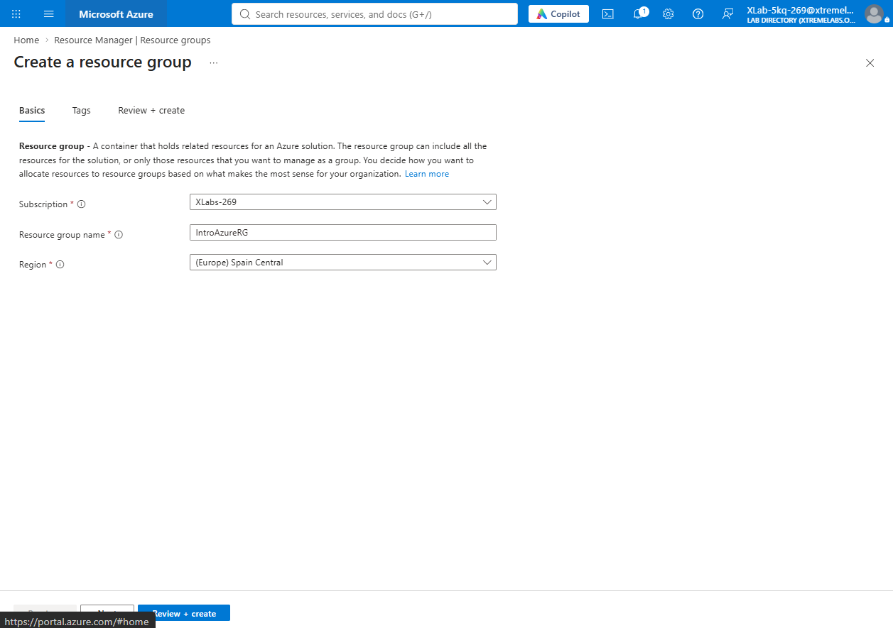
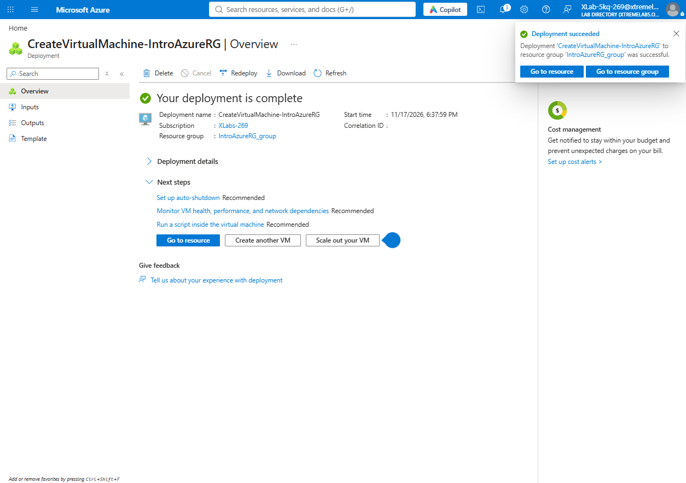
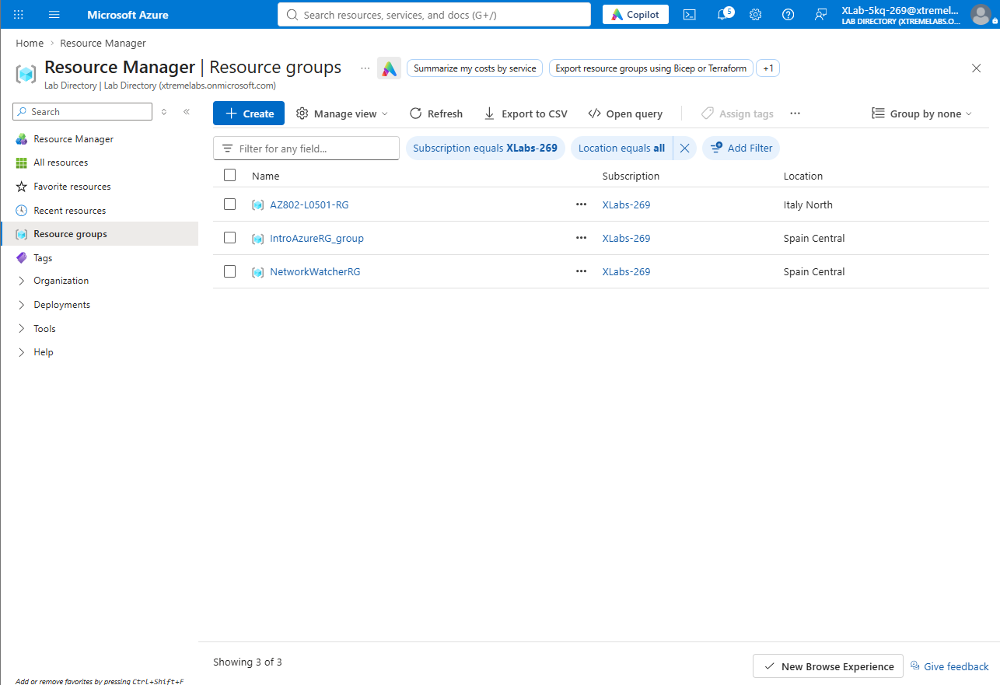

# Create a Virtual Machine and Configure It as a Web Host

## Overview

This lab creates a Linux virtual machine in Azure, installs the Nginx web server, and configures network access to make the hosted web page accessible from the internet.

It uses the services Resource groups, Virtual Machines, Azure Cloud Shell, Custom Script Extension, and Network Security Groups (NSGs).

Based on the official exercise: [Create a virtual machine and configure as a web host](https://microsoftlearning.github.io/AZ-900-Microsoft-Azure-Fundamentals/Instructions/Labs/03-exercise-create-azure-virtual-machine.html).

Region used: Spain Central.

## Steps

### 1. Create a resource group

1. In the Azure portal, open **Resource groups** and select **Create**.
2. Select the subscription, name the group `IntroAzureRG`, and choose a region where the required VM sizes are available.
3. Select **Review + create** and then **Create**.

### 2. Create a Linux virtual machine

1. Select **Create a resource**, then **Infrastructure services**, and create a **Virtual machine**.
2. On the **Basics** tab, set the following values and leave the rest as default:
   - Resource group: `IntroAzureRG`
   - Virtual machine name: `my-vm`
   - Region: same as the resource group
   - Authentication: password
   - Username: `azureuser`
   - Password: enter a custom password
   - Public inbound ports: leave the default settings
3. Select **Review + create** and then **Create**, and wait for the deployment to finish.

The Basics tab with the values used:



The deployment finished:



### 3. Install Nginx using Custom Script Extension

1. Open **Azure Cloud Shell** and make sure it is running in **Bash** mode.
2. Run the following Azure CLI command to install Nginx on the virtual machine:

   ```bash
   az vm extension set \
     --resource-group "IntroAzureRG" \
     --vm-name my-vm \
     --name customScript \
     --publisher Microsoft.Azure.Extensions \
     --version 2.1 \
     --settings '{"fileUris":["https://raw.githubusercontent.com/MicrosoftDocs/mslearn-welcome-to-azure/master/configure-nginx.sh"]}' \
     --protected-settings '{"commandToExecute": "./configure-nginx.sh"}'
   ```

The Custom Script Extension downloads and executes a Bash script that installs Nginx and configures the default web page with a welcome message containing the virtual machine's hostname.

### 4. Verify the initial web server connectivity

1. Retrieve the virtual machine's IP address and store it in a Bash variable:

   ```bash
   IPADDRESS="$(az vm list-ip-addresses \
     --resource-group "IntroAzureRG" \
     --name my-vm \
     --query "[].virtualMachine.network.publicIpAddresses[*].ipAddress" \
     --output tsv)"
   ```

2. Run the following command to attempt to retrieve the web page:

   ```bash
   curl --connect-timeout 5 http://$IPADDRESS
   ```

The connection should time out because inbound HTTP traffic on port 80 is not yet allowed by the network security configuration.

### 5. Review the Network Security Group rules

1. Retrieve the Network Security Group (NSG) associated with the virtual machine:

   ```bash
   NSGID="$(az network nic list \
     --resource-group "IntroAzureRG" \
     --query "[?virtualMachine.id && contains(virtualMachine.id, '/my-vm')].networkSecurityGroup.id | [0]" \
     --output tsv)"

   NSGNAME="${NSGID##*/}"
   echo $NSGNAME
   ```

2. List the rules associated with the NSG:

   ```bash
   az network nsg rule list \
     --resource-group "IntroAzureRG" \
     --nsg-name "$NSGNAME"
   ```

3. Use the following command to display the rules in a more readable table:

   ```bash
   az network nsg rule list \
     --resource-group "IntroAzureRG" \
     --nsg-name "$NSGNAME" \
     --query '[].{Name:name, Priority:priority, Port:destinationPortRange, Access:access}' \
     --output table
   ```

By default, the NSG allows inbound SSH traffic on port 22, but HTTP traffic on port 80 is not allowed.

### 6. Create a network security rule for HTTP

1. Create a rule named `allow-http` to allow inbound TCP traffic on port 80:

   ```bash
   az network nsg rule create \
     --resource-group "IntroAzureRG" \
     --nsg-name "$NSGNAME" \
     --name allow-http \
     --protocol tcp \
     --priority 100 \
     --destination-port-range 80 \
     --access Allow
   ```

2. Verify that the new rule has been added:

   ```bash
   az network nsg rule list \
     --resource-group "IntroAzureRG" \
     --nsg-name "$NSGNAME" \
     --query '[].{Name:name, Priority:priority, Port:destinationPortRange, Access:access}' \
     --output table
   ```

The NSG should now include the default SSH rule and the new `allow-http` rule.

### 7. Verify the web server

1. Run the same `curl` command again:

   ```bash
   curl --connect-timeout 5 http://$IPADDRESS
   ```

2. Verify that the web server returns the welcome page.
3. Optionally, open the web server in a browser to verify that the welcome page is displayed.

The welcome page confirms that Nginx is running and that inbound HTTP traffic is allowed.


### 8. Clean up

1. In the Azure portal, open **Resource groups**.
2. Select `IntroAzureRG`.
3. Select **Delete resource group**.
4. If present, check the force delete option for virtual machines and virtual machine scale sets.
5. Type `IntroAzureRG` to confirm and select **Delete**.

Deleting the resource group removes the virtual machine and all associated resources created during the lab, avoiding unnecessary costs.



## Result

The Linux virtual machine was successfully deployed and configured as a web host using Nginx.

Initially, the web server was not accessible because the Network Security Group did not allow inbound HTTP traffic. After creating the `allow-http` rule for TCP port 80, the web server became accessible and returned its welcome page.

The lab also demonstrated how Azure Cloud Shell and the Custom Script Extension can be used to configure a virtual machine after deployment.

## Lessons Learned

- Deploying a virtual machine involves configuring several associated Azure resources, including networking components.
- The Custom Script Extension allows scripts to be executed on a virtual machine after deployment, simplifying software installation and configuration.
- Network Security Groups control inbound and outbound network traffic through security rules.
- By default, the Linux VM's NSG allowed SSH traffic on port 22, but HTTP traffic on port 80 had to be explicitly allowed.
- A successful VM deployment does not necessarily mean that the services running on it are accessible from the internet.
- Deleting the resource group removes the resources created during the lab and helps prevent unnecessary costs.

## References

- [Official AZ-900 lab instructions - Create a virtual machine and configure as a web host](https://microsoftlearning.github.io/AZ-900-Microsoft-Azure-Fundamentals/Instructions/Labs/03-exercise-create-azure-virtual-machine.html)
- [Azure Virtual Machines documentation](https://learn.microsoft.com/azure/virtual-machines/)
- [Network Security Groups documentation](https://learn.microsoft.com/azure/virtual-network/network-security-groups-overview)
- [Custom Script Extension for Linux](https://learn.microsoft.com/azure/virtual-machines/extensions/custom-script-linux)
